# PMM_C4Timer

[](https://boosty.to/rimmerquinella)

<h3 align="center">Больше моих плагинов и более подробная информация на моем сайте</h3>
<h2 align="center"><a href="https://genesis-cs.space/menuconstructor/menumanager/plugins/">GENESIS-CS.SPACE</a></h2>
<a href="https://genesis-cs.space/menuconstructor/menumanager/plugins/">
  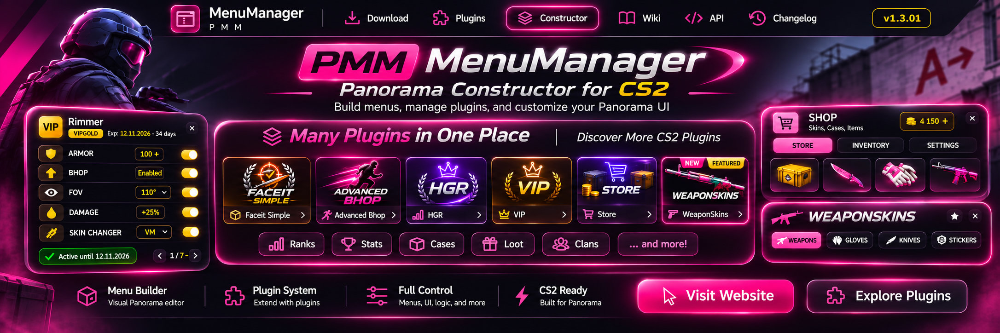
</a>

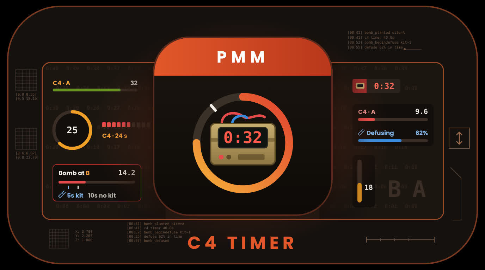

C4 timer on the CS2 Panorama HUD by **Rimmer**, in the style of [PanoramaMenuManager](https://github.com/RRimmer/PanoramaMenuManagerCS2) plugins.

Current version: **0.1.0**. Needs CounterStrikeSharp 1.0.377 (.NET 10). PMM Core (MenuManagerCS2) 1.2.03+ is optional: it gives the `!c4` menu, without it the settings are chat commands.

- 8 styles: 1 digits, 2 bar with the site, 3 ring, 4 card with defuse marks (5 s with a kit / 10 s without), 5 segments, 6 vertical bar, 8 chip like the round timer, 9 timer with defuse progress.
- 5 positions: under the players, under the radar, below the crosshair, bottom, right.
- Colour by time left: green, amber from 20 s, red and blinking from 10 s. Bars move smoothly.
- Every player picks their own style, position, on / off (`!c4`), with a 10 second preview that only they see.
- Who sees the timer (`Show`) and who sees the defuse (`ShowDefuse`): alive CT, alive T, dead players, spectators. By default alive T get only the bomb timer.
- Translations `ru`, `en`, per player language.

## Styles

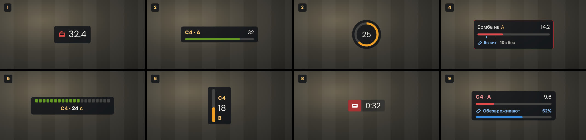

| # | Look | Style |
| :---: | --- | --- |
| **1** | 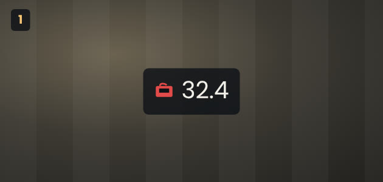 | **Digits**<br>Bomb icon and the time with tenths. Turns red under 10 s. |
| **2** | 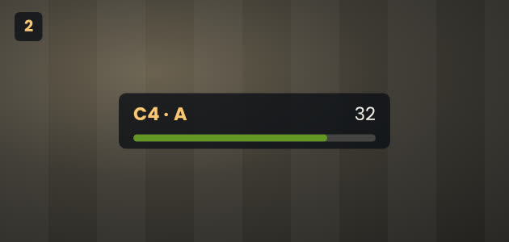 | **Bar**<br>Site and seconds above a bar. Green → amber → red. |
| **3** | 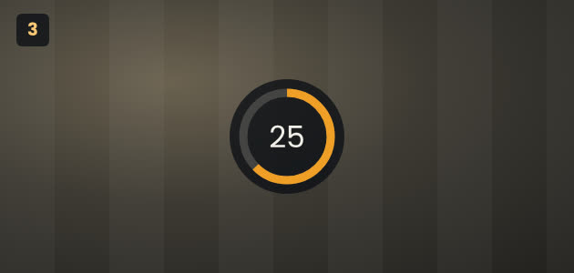 | **Ring**<br>A ring that empties, seconds inside. |
| **4** | 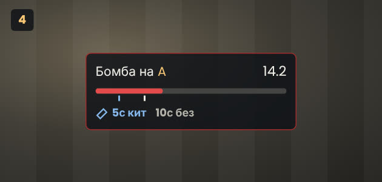 | **Card with defuse ticks (default)**<br>"Bomb at A", time, bar and two ticks: 5 s (kit) and 10 s (no kit). A tick turns red when there is no time left for that defuse. |
| **5** | 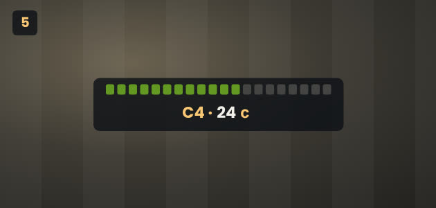 | **Segments**<br>20 LED segments and seconds. |
| **6** | 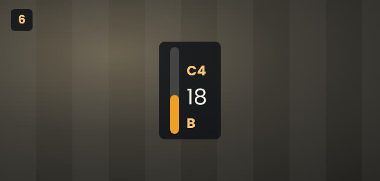 | **Vertical bar**<br>Narrow bar for the side of the screen, seconds and site. |
| **8** | 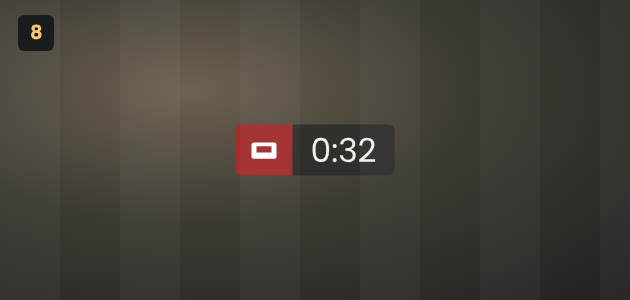 | **Chip**<br>Like the CS2 round timer: bomb and 0:32. |
| **9** | 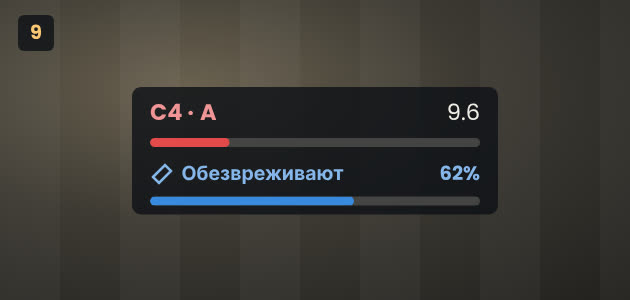 | **Timer and defuse**<br>Time and bar; while someone defuses: kit icon, percent and a second bar — blue if the defuse ends in time, grey if not. Only for players allowed by `ShowDefuse`. |

Positions: `top` under the players, `radar` under the radar, `cross` below the crosshair, `bottom`, `right`. Every player picks style and position in `!c4`.

## Repository layout

| Folder | What it is |
| --- | --- |
| `PMM_C4Timer` | The plugin: `Plugin.cs` (events, tick), `Bomb.cs` (planted bomb), `Hud.cs` (HUD entity, painting), `Players.cs` (choice, visibility, preview, chat commands), `Menu.cs` (PMM core menu), `Config.cs` |
| `PMM_C4Timer/panorama` | Client files for the MultiAddonManager addon: `pmm_c4timer.xml`, `pmm_c4timer.css`, `pmm_c4timer_ladder.css` |
| `PMM_C4Timer/lang` | Translations `ru.json`, `en.json` |
| `tools/gen_layout.py` | Writes `pmm_c4timer.xml` and `pmm_c4timer_ladder.css` |
| `MenuManagerApi` | Compile-time library (PMM Core API). Do not copy `MenuManagerApi.dll` next to this plugin |
| `configs` | Example config |
| `images` | README pictures: banner and the 8 styles |

## Install from a Release

Copy `Server-plugins/counterstrikesharp` into `game/csgo/addons/`:

- `plugins/PMM_C4Timer/PMM_C4Timer.dll`
- `plugins/PMM_C4Timer/lang/ru.json`, `lang/en.json`
- `configs/plugins/PMM_C4Timer/PMM_C4Timer.jsonc` (JSON with comments; the plugin reads it itself, `css_pmm_c4 reload` after an edit)

Copy `Content-addonmanager/panorama` into the MultiAddonManager addon and rebuild it in Workshop Tools.

## Commands

- `!c4` — menu: on / off, style, position, preview.
- `!c4 on`, `!c4 off`, `!c4 1…9` (style), `!c4 top|radar|cross|bottom|right` (position), `!c4 test` (preview), `!c4 help`.
- Server console: `css_pmm_c4` — status.

## Config (`PMM_C4Timer.jsonc`)

| Key | Default | What it does |
| --- | --- | --- |
| `DefaultStyle` | `4` | style of a player who did not pick one (1, 2, 3, 4, 5, 6, 8, 9) |
| `DefaultPosition` | `top` | `top`, `radar`, `cross`, `bottom`, `right` |
| `Styles` / `Positions` | all | what a player can pick |
| `AllowPlayerChoice` | `true` | `false`: defaults for everyone, `!c4` only turns it on / off |
| `Show.AliveCT` / `AliveT` / `Dead` / `Spectators` | `true` | who sees the timer |
| `ShowDefuse.AliveCT` / `AliveT` / `Dead` / `Spectators` | `true` / `false` / `true` / `true` | who sees that the bomb is being defused (style 9). Others get only the bomb timer: the server sends them no defuse data |
| `WarnSeconds` / `CritSeconds` | `20` / `10` | amber / red phase |
| `HideDelay` | `0` | seconds the timer stays after a defuse / explosion |
| `UpdateInterval` | `0.1` | update rate, seconds |
| `LayoutPath` | `panorama/layout/custom_game/pmm_c4timer.vxml_c` | compiled layout in the addon |

## Build

```
dotnet build PMM_C4Timer.sln -c Release
```

---

# PMM_C4Timer


<h2><a href="https://genesis-cs.space/menuconstructor/index.html">>>>Более подробная информация на сайте<<<</a></h2>

Таймер C4 на панораме CS2 от **Rimmer**, в стиле плагинов [PanoramaMenuManager](https://github.com/RRimmer/PanoramaMenuManagerCS2).

Текущая версия: **0.1.0**. Нужен CounterStrikeSharp 1.0.377 (.NET 10). PMM Core (MenuManagerCS2) 1.2.03+ не обязателен: с ним есть меню `!c4`, без него настройки — командами в чат.

- 8 видов: 1 — цифры, 2 — полоса с точкой, 3 — кольцо, 4 — плашка с метками дефьюза (5 с с китом / 10 с без), 5 — сегменты, 6 — вертикальная шкала, 8 — чип как у таймера раунда, 9 — таймер и прогресс дефьюза.
- 5 мест: под игроками, под радаром, под прицелом, внизу, справа.
- Цвет по оставшемуся времени: зелёный, жёлтый с 20 с, красный и мигание с 10 с. Полосы двигаются плавно.
- Каждый игрок выбирает свой вид, место и вкл/выкл (`!c4`), с примером на 10 секунд, который видит только он.
- Кому показывать таймер (`Show`) и дефьюз (`ShowDefuse`): живым CT, живым T, мёртвым, наблюдателям. По умолчанию живые T видят только таймер бомбы.
- Переводы `ru`, `en`, по языку игрока.

## Виды


| № | Как выглядит | Вид |
| :---: | --- | --- |
| **1** |  | **Цифры**<br>Иконка бомбы и время с десятыми. Меньше 10 с — красное. |
| **2** |  | **Полоса**<br>Точка и секунды над полосой. Зелёный → жёлтый → красный. |
| **3** |  | **Кольцо**<br>Кольцо убывает, внутри секунды. |
| **4** |  | **Плашка с метками (по умолчанию)**<br>«Бомба на A», время, полоса и две засечки: 5 с (кит) и 10 с (без кита). Засечка краснеет, когда на такой дефьюз уже не хватает времени. |
| **5** |  | **Сегменты**<br>20 LED-сегментов и секунды. |
| **6** |  | **Вертикальная шкала**<br>Узкая шкала для края экрана, секунды и точка. |
| **8** |  | **Чип**<br>Как таймер раунда CS2: бомба и 0:32. |
| **9** |  | **Таймер и дефьюз**<br>Время и полоса; пока обезвреживают — кит, процент и вторая полоса: синяя, если успевает, серая, если нет. Только тем, кому разрешено в `ShowDefuse`. |

Места: `top` — под игроками, `radar` — под радаром, `cross` — под прицелом, `bottom` — внизу, `right` — справа. Каждый игрок выбирает вид и место в `!c4`.

## Установка из релиза

Скопируйте `Server-plugins/counterstrikesharp` в `game/csgo/addons/`. Содержимое `Content-addonmanager/panorama` — в аддон MultiAddonManager, затем пересоберите аддон в Workshop Tools. Подробно — `INSTALL.md`.

## Команды

- `!c4` — меню: вкл/выкл, вид, место, пример.
- `!c4 on`, `!c4 off`, `!c4 1…9` (вид), `!c4 top|radar|cross|bottom|right` (место), `!c4 test` (пример), `!c4 help`.
- Консоль сервера: `css_pmm_c4` — состояние.
